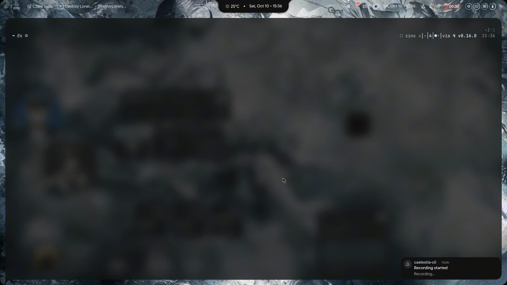

# zinc

A Wayland terminal emulator written in Zig.

<p align="center">
  
</p>

Keep in mind this is still experimental and you will surely find issues. If you report them in the issues I would really appreciate it and will work on the fix. I am doing this project to learn, not competing with other terminals, although zinc is faster in some tasks and has niche features.

## Highlights

The cursor glides to its cell over 60ms instead of teleporting. Scrolling pours instead of jumping, with a scrollbar that fades when idle. Ctrl+click a file to open it in your editor, Ctrl+click a folder to cd into it, Shift+click to open the file manager. Images render inline through the Kitty graphics protocol, so tools like yazi show real previews. Fonts auto-discover with CJK and emoji fallback, and Ctrl+plus/minus zooms.

Everything lives in `~/.config/zinc/config`, created on first launch and never rewritten. Tune `cursor-glide-ms`, `smooth-scroll-ms`, or `scroll-step` and restart.

If you want to see the full breakdown of everything zinc does, check [features.md](features.md).


## Dependencies

- Zig 0.16.0
- wayland-client
- libxkbcommon
- freetype2
- fontconfig

On Arch:

```bash
sudo pacman -S zig wayland libxkbcommon freetype2 fontconfig
```

Note: built with Zig 0.16.0.

## Build

Build the release binary:

```bash
zig build -Doptimize=ReleaseSafe
```

Run the binary:

```bash
./zig-out/bin/zinc
```

To compile-check without installing or running anything:

```bash
zig build check
```

## Install

To install for your user only (no root required):

```bash
zig build -Doptimize=ReleaseSafe --prefix ~/.local
update-desktop-database ~/.local/share/applications
```

This installs the binary to `~/.local/bin/zinc` and registers the desktop launcher, multi-res transparent icons, and AppStream metadata in `~/.local/share/`.

Make sure `~/.local/bin` is in your `PATH`:
- **fish**: `fish_add_path ~/.local/bin`
- **bash / zsh**: add `export PATH="$HOME/.local/bin:$PATH"` to your `~/.bashrc` or `~/.zshrc`

For system-wide installation:

```bash
sudo zig build -Doptimize=ReleaseSafe --prefix /usr/local
sudo update-desktop-database /usr/local/share/applications
```

On Arch Linux, you can also build and install directly using the included `PKGBUILD`:

```bash
makepkg -si
```

## Uninstall

To uninstall, run the built-in uninstall command pointing to your prefix:

```bash
zig build uninstall --prefix ~/.local
update-desktop-database ~/.local/share/applications
```

Or for system-wide installs:

```bash
sudo zig build uninstall --prefix /usr/local
sudo update-desktop-database /usr/local/share/applications
```

Your configuration at `~/.config/zinc/config` stays untouched.


## Known issues

- Hard resizes can strand one stray character. Content restores fine.
  Cause unknown, see `src/term/reflow.zig`.
