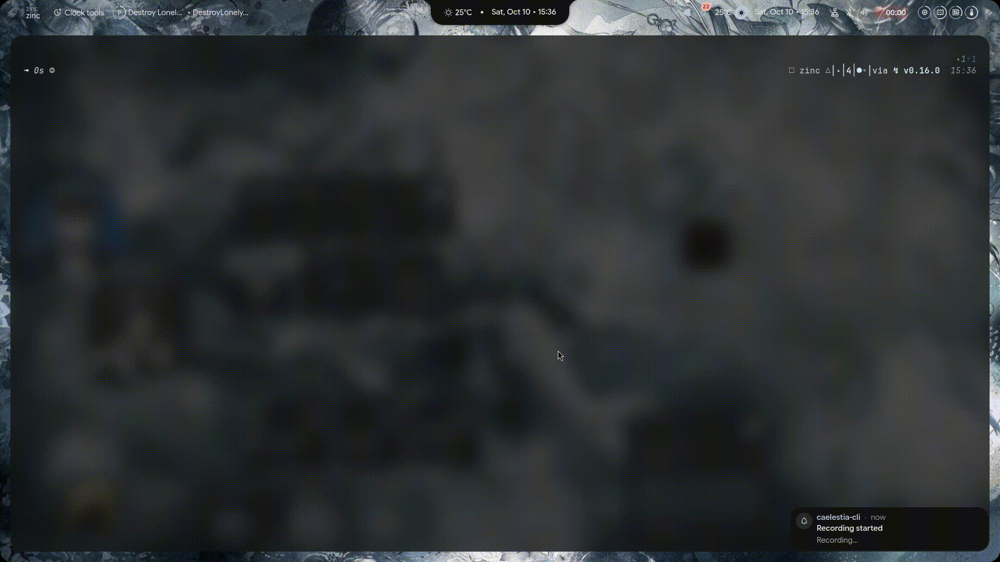

# zinc

A Wayland terminal emulator written in Zig.

<p align="center">
  
</p>

Keep in mind this is still experimental and you will surely find issues. If you report them in the issues I would really appreciate it and will work on the fix. I am doing this project to learn, not competing with other terminals, although zinc is faster in some tasks and has niche features.

## Highlights

- **Smooth motion**: configurable cursor glide and scrolling.
- **Kitty graphics**: inline image previews for `yazi`, `chafa`, etc.
- **Adaptive TUI padding**: pads your shell, but drops to 0px edge-to-edge in full-screen apps (`nvim`, `btop`, `yazi`).
- **Smart click**: `Ctrl+click` files to open in your editor, `Ctrl+click` folders to `cd`.
- **Lightweight**: memory footprint stays around ~23MB in a maximized window.

Full breakdown in [features.md](features.md).


## Dependencies

- Zig 0.17.0
- wayland-client
- libxkbcommon
- freetype2
- fontconfig
- hicolor-icon-theme

On Arch:

```bash
sudo pacman -S zig wayland libxkbcommon freetype2 fontconfig hicolor-icon-theme
```

Note: built with Zig 0.17.0.

## Build

Build the release binary:

```bash
zig build -Doptimize=ReleaseSafe
```

Run the binary:

```bash
./zig-out/bin/zinc
```

To compile-check without installing or running anything:

```bash
zig build check
```

## Install

### Arch Linux

Available on the AUR as [`zinc-term`](https://aur.archlinux.org/packages/zinc-term) (release) or [`zinc-term-git`](https://aur.archlinux.org/packages/zinc-term-git) (git):

```bash
paru -S zinc-term
# or
yay -S zinc-term
```

For the latest git master:

```bash
paru -S zinc-term-git
# or
yay -S zinc-term-git
```

### From source

To install for your user only (no root required):

```bash
zig build -Doptimize=ReleaseSafe --prefix ~/.local
update-desktop-database ~/.local/share/applications
```

This installs the binary to `~/.local/bin/zinc` and registers the desktop launcher, multi-res transparent icons, and AppStream metadata in `~/.local/share/`.

Make sure `~/.local/bin` is in your `PATH`:
- **fish**: `fish_add_path ~/.local/bin`
- **bash / zsh**: add `export PATH="$HOME/.local/bin:$PATH"` to your `~/.bashrc` or `~/.zshrc`

For system-wide installation:

```bash
sudo zig build -Doptimize=ReleaseSafe --prefix /usr/local
sudo update-desktop-database /usr/local/share/applications
```

## Uninstall

To uninstall, run the built-in uninstall command pointing to your prefix:

```bash
zig build uninstall -Duninstall-prefix=$HOME/.local
update-desktop-database ~/.local/share/applications
```

Or for system-wide installs:

```bash
sudo zig build uninstall -Duninstall-prefix=/usr/local
sudo update-desktop-database /usr/local/share/applications
```

Your configuration at `~/.config/zinc/config` stays untouched.
